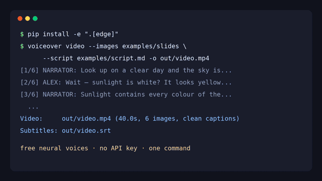
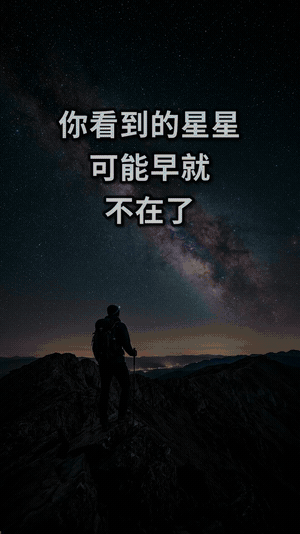

<div align="center">

[English](README.md) · [简体中文](README.zh-CN.md) · [日本語](README.ja.md) · **Español**

# AI Voiceover Studio — locución con IA, texto a voz y clonación de voz para YouTube y vídeos sin rostro

**AI Voiceover Studio es una herramienta de línea de comandos y librería de Python de código abierto que convierte un guion en Markdown en una locución con IA, subtítulos SRT y un vídeo sin rostro (faceless) con subtítulos, con un solo comando. Funciona al instante con voces neuronales gratuitas (sin cuenta ni clave de API) y se conecta a Miragea para clonación de voz y voces expresivas.**

[](https://github.com/yanghhu/ai-voiceover-studio/actions/workflows/tests.yml)
[](https://www.python.org/)
[](LICENSE)

<table>
<tr>
<td align="center"></td>
<td align="center"></td>
</tr>
<tr>
<td align="center"><sub>16:9 YouTube · <a href="docs/assets/demo.mp4">vídeo completo con sonido (MP4, 34 s)</a></sub></td>
<td align="center"><sub>9:16 Short · <a href="docs/assets/demo-short-zh.mp4">MP4, 23 s</a></sub></td>
</tr>
</table>

<sub>Salida real de un solo comando cada uno, sin editar: voz gratuita de Edge, música ambiental generada con ducking bajo la voz, B-roll de <a href="examples/broll">examples/broll</a> · <a href="docs/assets/sample-voiceover.mp3">solo la locución (MP3)</a> · <a href="docs/assets/sample-voiceover.srt">subtítulos (SRT)</a></sub>

</div>

## Inicio rápido (tres líneas)

```bash
git clone https://github.com/yanghhu/ai-voiceover-studio && cd ai-voiceover-studio
pip install -e ".[edge]"
voiceover video --script examples/demo.en.md --style tiktok --music ambient -o out/video.mp4
```

Eso es todo. Obtienes `out/video.mp4` (1080p: B-roll por párrafo con Ken Burns y transiciones, gancho animado, subtítulos palabra por palabra y música que baja sola bajo la voz), `out/video.srt` y la pista de locución en `out/video_voiceover/`. Necesita Python 3.9+ y [ffmpeg](https://ffmpeg.org); `voiceover doctor` comprueba ambos.

```bash
voiceover script examples/script.md -o out/      # solo audio: out/voiceover.mp3 + .srt + manifest.json
voiceover say "¡Bienvenidos de nuevo al canal!" -o hola.mp3
voiceover doctor                                 # ffmpeg, motores, claves y fuentes
```

No hace falta archivo de voces: cada personaje del guion recibe automáticamente una voz distinta según el idioma del guion.

## Funciones

| | Qué obtienes |
| --- | --- |
| 🆓 **Sin registro** | el motor por defecto son las voces neuronales gratuitas de Microsoft Edge (`edge-tts`): 322 voces y 75 idiomas, sin cuenta ni clave |
| 🎭 **Varios personajes** | líneas `[NARRADOR]:` / `[ALEX]:`; cada personaje recibe su propia voz automáticamente, o asígnalas en `voices.json` |
| 🎞️ **Vídeo sin rostro** | B-roll por párrafo (`` en el guion) → MP4 con Ken Burns, transiciones de deslizamiento / zoom / fundido, etalonaje cinematográfico y tarjeta de gancho animada |
| 🔤 **Subtítulos animados** | resaltado palabra por palabra al estilo TikTok / CapCut con tiempos reales, efecto pop, palabras clave en color (`**negrita**` en el guion), zonas seguras 9:16 y 16:9 |
| 🎵 **Música con ducking** | pistas ambientales generadas por el propio proyecto (sin licencias) o tu archivo, bajando automáticamente mientras habla la voz |
| ✨ **Sin imágenes, también se ve bien** | los párrafos sin B-roll muestran un degradado animado con tipografía cinética de la frase clave |
| 💬 **Subtítulos precisos** | SRT a partir de los límites de frase del motor, o por reconocimiento de voz; ajuste de líneas compatible con CJK |
| 🎨 **Estilos de subtítulos** | `tiktok` (por defecto en vertical), `clean` (por defecto en horizontal), `bold`, `minimal`, `box`; se adaptan a 16:9 y 9:16 |
| 🧬 **Clonación de voz** | con el motor Miragea: la URL de un audio de referencia (y su transcripción) como voz |
| ♻️ **Repetir de forma segura** | caché por línea y claves de idempotencia deterministas |
| 🔌 **Motores intercambiables** | `edge`, `miragea`, `openai`, `dummy` sin conexión, o el tuyo con la interfaz `VoiceProvider` |
| 🩺 **`voiceover doctor`** | revisa ffmpeg (libass), motores, claves de API y fuentes CJK, y te dice cómo arreglar cada cosa |
| 🪶 **Núcleo ligero** | solo la biblioteca estándar; los motores son extras opcionales; el vídeo lo renderiza ffmpeg directamente |

## Motores de voz

| Motor | Configuración | Ideal para |
| --- | --- | --- |
| `edge` (por defecto sin clave) | `pip install -e ".[edge]"`, sin cuenta ni clave | probar, borradores, muchos idiomas |
| `miragea` (por defecto con `MIRAGEA_API_KEY`) | `export MIRAGEA_API_KEY=...` ([crear clave](https://miragea.ai/workspace/api)) | clonación de voz, modelos expresivos con etiquetas de emoción, reconocimiento de subtítulos |
| `openai` | `export OPENAI_API_KEY=...` | voces de OpenAI (`alloy`, `nova`, `onyx`...) |
| `dummy` | nada (`--dry-run`) | pruebas sin conexión y CI |

Elige con `--provider NOMBRE` o `VOICEOVER_PROVIDER`. `voiceover voices --provider edge --filter es-` lista las voces de Edge (p. ej. `es-ES-ElviraNeural`). Las claves solo se leen del entorno y nunca se imprimen ni se guardan. Las voces de Edge provienen del servicio de lectura en línea de Microsoft (mediante el paquete comunitario `edge-tts`) y requieren conexión a internet.

## Guiones con varios personajes (diálogo y doblaje)

```markdown
[NARRADOR]: En un día despejado el cielo es azul. Pero la luz del sol es blanca.
[ALEX](tags=curious): ¿Blanca? A mí me parece amarilla.
[pause 0.8]
[NARRADOR](speed=1.05): La luz azul, de onda corta, se dispersa mucho más en la atmósfera.
```

`[NOMBRE]:` define quién habla, las líneas sin etiqueta continúan con el mismo personaje, una línea en blanco empieza un segmento nuevo y `[pause 1.5]` inserta silencio. Sin archivo de voces, cada personaje recibe una voz distinta automáticamente; para elegirlas tú, usa `voices.json` ([ejemplo](examples/voices.example.json)).

## Clonación de voz con un audio de referencia

La clonación de voz usa el motor Miragea (`MIRAGEA_API_KEY`).

```bash
voiceover say "Esta es mi propia voz, generada a partir de texto." \
  --voice https://example.com/mi-voz.wav --ref-text "Lo que dije exactamente en mi-voz.wav." \
  --lang es -o clonada.mp3
```

Clona solo tu propia voz o voces para las que tengas permiso explícito.

## Subtítulos (SRT) para YouTube

`--subtitles timing` (por defecto, texto literal del guion, sin llamadas extra a la API), `recognize` (reconocimiento de voz sobre la mezcla final) o `none`.

## Vídeo de YouTube y Shorts sin rostro a partir de un guion

El B-roll va en el propio guion: una línea de imagen Markdown define la imagen o el clip del párrafo siguiente, y las palabras en `**negrita**` se resaltan en los subtítulos.

```bash
voiceover video --script examples/demo.en.md --style tiktok --music ambient -o video.mp4   # 16:9 YouTube
voiceover video --script examples/demo.zh.md --vertical --music ambient -o short.mp4       # 9:16 Shorts / Reels / TikTok
voiceover video --script notas.md -o explicacion.mp4                                       # sin imágenes: tipografía cinética
```

Opciones principales: `--style tiktok|clean|bold|minimal|box` (`tiktok` por defecto en vertical, `clean` en horizontal), `--music ambient|pulse|ARCHIVO` (`ambient` y `pulse` se sintetizan con el código del proyecto al renderizar, sin licencias), `--music-volume 0-1` (0,5), `--no-duck`, `--hook TEXTO` / `--no-hook` (por defecto el primer título `#`), `--vertical`, `--transition-style mix|fade|slide|zoom|cut`, `--grade cinematic|none`, `--images CARPETA` (para párrafos sin ``), `--font`. El vídeo se genera con una sola llamada a ffmpeg, sin librerías de vídeo de Python.

## Idiomas compatibles

- **edge**: 75 idiomas (`voiceover voices --provider edge`); voz automática para español, inglés, chino, japonés, coreano, francés, alemán, italiano, portugués y ruso según el texto o `--lang`.
- **miragea**: chino, inglés, japonés, coreano, alemán, francés, ruso, portugués, español e italiano, con clonación de voz.

## Preguntas frecuentes

Más respuestas en [docs/FAQ.md](docs/FAQ.md) (en inglés).

**¿Cómo añado una locución con IA a un vídeo de YouTube?** Escribe la narración en Markdown, ejecuta `voiceover script`, coloca `voiceover.mp3` en tu editor y sube `voiceover.srt` como subtítulos.

**¿Puedo clonar mi propia voz?** Sí: publica una grabación en una URL accesible para la API y usa `--voice` con `--ref-text`.

**¿Necesito una clave de API?** No. El motor `edge` por defecto es gratuito y sin cuenta, y `--dry-run` funciona sin conexión. Una clave de Miragea añade clonación de voz y voces expresivas.

## Arquitectura, comparación y hoja de ruta

Consulta [Architecture](README.md#architecture), [How it compares](README.md#how-it-compares) y [Roadmap](README.md#roadmap) en la versión en inglés.

## Contribuir

Se agradecen issues y pull requests. Consulta [CONTRIBUTING.md](CONTRIBUTING.md); las pruebas (`pytest`) funcionan sin conexión.

## Licencia

[MIT](LICENSE) © 2026 Miragea contributors
