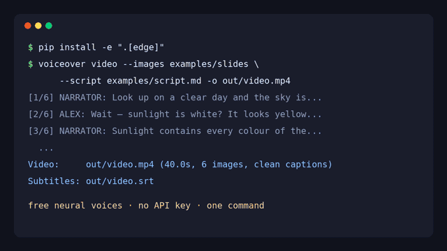

<div align="center">

[English](README.md) · [简体中文](README.zh-CN.md) · **日本語** · [Español](README.es.md)

# AI Voiceover Studio — YouTube・顔出しなし動画のための AI ナレーション、音声合成（TTS）、ボイスクローン

**AI Voiceover Studio は、Markdown の台本をコマンド一つで AI ナレーション、SRT 字幕、字幕付きの顔出しなし（faceless）動画に変えるオープンソースの Python CLI／ライブラリです。無料のニューラル音声ですぐに動き（アカウント・API キー不要）、Miragea を使えばボイスクローンや表現力豊かな声も利用できます。**

[](https://github.com/yanghhu/ai-voiceover-studio/actions/workflows/tests.yml)
[](https://www.python.org/)
[](LICENSE)



<sub>実際の出力（無編集）：[音声付きの動画（MP4、40 秒）](docs/assets/demo.mp4) · [ナレーションのみ（MP3）](docs/assets/sample-voiceover.mp3) · [字幕（SRT）](docs/assets/sample-voiceover.srt) · [中国語の縦型ショート（MP4）](docs/assets/demo-short-zh.mp4)</sub>

</div>

## クイックスタート（3 行）

```bash
git clone https://github.com/yanghhu/ai-voiceover-studio && cd ai-voiceover-studio
pip install -e ".[edge]"
voiceover video --images examples/slides --script examples/script.md -o out/video.mp4
```

これだけです。`out/video.mp4`（1080p、2 人の声、Ken Burns モーション、焼き込み字幕）、`out/video.srt`、`out/video_voiceover/` のナレーション音声ができます。必要なのは Python 3.9+ と [ffmpeg](https://ffmpeg.org) で、`voiceover doctor` が確認します。

```bash
voiceover script examples/script.md -o out/      # 音声のみ：out/voiceover.mp3 + .srt + manifest.json
voiceover say "チャンネルへようこそ！" -o hello.mp3
voiceover doctor                                 # ffmpeg・エンジン・キー・フォントを確認
```

声の設定ファイルは不要です。台本の話者ごとに、台本の言語に合った別々の声が自動で割り当てられます。

## 機能

| | 内容 |
| --- | --- |
| 🆓 **登録不要** | 既定エンジンは無料の Microsoft Edge ニューラル音声（`edge-tts`）。322 音声・75 言語、アカウントもキーも不要 |
| 🎭 **複数話者の台本** | `[NARRATOR]:` `[ALEX]:` と書くだけで話者ごとに別の声。`voices.json` で指定も可能 |
| 🎞️ **顔出しなし動画** | 画像（または台本だけ）→ Ken Burns ズーム、クロスフェード、進捗バー、スタイル付き焼き込み字幕の MP4 |
| 💬 **正確な字幕** | エンジンの文境界から SRT を生成、または完成音声を音声認識。CJK の改行に対応 |
| 🎨 **字幕スタイル** | `clean`・`box`・`bold`（ショート向け）・`minimal`、話者ラベル、横長／縦長に自動対応 |
| 🧬 **ボイスクローン** | Miragea エンジンで、参照音声の URL（と書き起こし）を声として使用 |
| ♻️ **安全な再実行** | セグメントキャッシュと決定的な冪等キーで、変更のない行は再生成しない |
| 🔌 **差し替え可能なエンジン** | `edge`・`miragea`・`openai`・オフライン `dummy`、または `VoiceProvider` で独自エンジン |
| 🩺 **`voiceover doctor`** | ffmpeg（libass）、エンジン、API キー、CJK フォントを確認し、修正方法を表示 |
| 🪶 **軽量なコア** | 標準ライブラリのみ。エンジンは任意の extra、動画は ffmpeg で直接レンダリング |

## 音声エンジン

| エンジン | 設定 | 向いている用途 |
| --- | --- | --- |
| `edge`（キー未設定時の既定） | `pip install -e ".[edge]"`、登録・キー不要 | お試し、下書き、多言語 |
| `miragea`（`MIRAGEA_API_KEY` 設定時の既定） | `export MIRAGEA_API_KEY=...`（[キーを作成](https://miragea.ai/workspace/api)） | 参照音声によるボイスクローン、感情タグ付きの表現力豊かなモデル、字幕認識 |
| `openai` | `export OPENAI_API_KEY=...` | OpenAI の声（`alloy`、`nova`、`onyx` など） |
| `dummy` | なし（`--dry-run`） | オフラインのテストと CI |

`--provider 名前` または `VOICEOVER_PROVIDER` で選択します。`voiceover voices --provider edge --filter ja-JP` で Edge の声（例 `ja-JP-NanamiNeural`）を一覧できます。キーは環境変数からのみ読み込まれ、表示・保存はされません。Edge の音声は Microsoft のオンライン読み上げサービス（コミュニティパッケージ `edge-tts` 経由）で、インターネット接続が必要です。

## 複数話者の台本（対話・吹き替え）

```markdown
[NARRATOR]: 晴れた日の空は青い。でも太陽の光は白い。青はどこから来るのでしょう？
[ALEX](tags=curious): 太陽の光って白いの？
[pause 0.8]
[NARRATOR](speed=1.05): 波長の短い青い光ほど、大気中で強く散乱されるのです。
```

`[名前]:` で話者を指定、タグのない行は直前の話者を継続、空行で新しいセグメント、`[pause 1.5]` で無音を挿入します。声の設定がなければ話者ごとに別の声が自動で割り当てられます。自分で選ぶ場合は `voices.json` に書きます（[例](examples/voices.example.json)）。

```bash
voiceover script script.md --voices voices.json -o out/
```

## 参照音声によるボイスクローン

ボイスクローンには Miragea エンジン（`MIRAGEA_API_KEY`）を使います。

```bash
voiceover say "テキストから生成した私自身の声です。" \
  --voice https://example.com/my-voice.wav --ref-text "my-voice.wav で実際に話した内容。" \
  --lang ja -o cloned.mp3
```

ご自身の声、または使用許可を得た声のみをクローンしてください。

## 字幕（SRT）

`--subtitles timing`（既定、台本の文字をそのまま使用し追加の API 呼び出しなし）、`recognize`（完成音声を音声認識）、`none` から選べます。日本語・中国語・韓国語の改行にも対応しています。

## 画像と台本から顔出しなし YouTube 動画を作る

```bash
voiceover video --images examples/slides --script examples/script.md -o video.mp4
voiceover video --script script.md -o short.mp4 --size 1080x1920 --style bold   # 縦型、画像なしでも可
voiceover video --images slides/ --script script.md -o video.mp4 --style box --speaker-labels
```

主なオプション：`--subtitles burn|sidecar|none`（既定 `burn`、`.srt` も出力）、`--style clean|box|bold|minimal`、`--motion kenburns|none`、`--transition 秒`（既定 0.5）、`--size 1080x1920`、`--title` / `--no-title`、`--speaker-labels`、`--font`（日本語字幕には CJK フォントが必要。`voiceover doctor` で確認）。画像の枚数がセグメント数と同じなら、各画像はそのセグメントの間だけ表示されます。動画は ffmpeg 1 回の呼び出しで描画され、Python の動画ライブラリは不要です。

## 対応言語

- **edge**：75 言語（`voiceover voices --provider edge`）。日・英・中・韓・西・仏・独・伊・葡・露は台本の文字または `--lang` から声を自動選択。
- **miragea**：中国語、英語、日本語、韓国語、ドイツ語、フランス語、ロシア語、ポルトガル語、スペイン語、イタリア語（ボイスクローン対応）。

## よくある質問

詳しくは [docs/FAQ.md](docs/FAQ.md)（英語）をご覧ください。

**YouTube 動画に AI ナレーションを付けるには？** 台本を Markdown で書き、`voiceover script` を実行して、`voiceover.mp3` を編集ソフトに配置し、`voiceover.srt` を字幕としてアップロードします。

**自分の声をクローンできますか？** はい。API から取得できる URL に録音を置き、`--voice` と `--ref-text` を指定します。

**API キーなしで使えますか？** はい。既定の `edge` エンジンは無料でアカウント不要、`--dry-run` は完全にオフラインです。Miragea のキーがあればボイスクローンや表現力豊かな声も使えます。

## アーキテクチャ・比較・ロードマップ

詳細は英語版の [Architecture](README.md#architecture)、[How it compares](README.md#how-it-compares)、[Roadmap](README.md#roadmap) を参照してください。

## コントリビュート

Issue・PR を歓迎します。[CONTRIBUTING.md](CONTRIBUTING.md) を参照し、`pip install -e ".[dev,edge]" && pytest`（オフライン）でテストしてください。

## ライセンス

[MIT](LICENSE) © 2026 Miragea contributors
