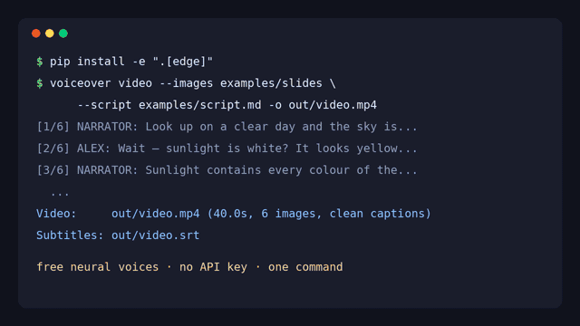
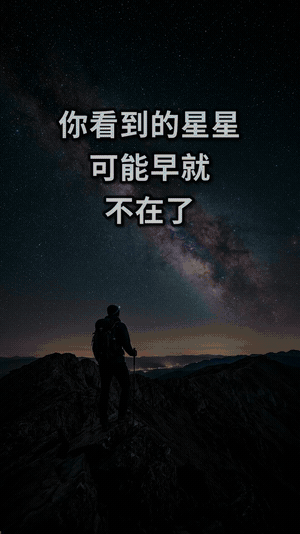

<div align="center">

**English** · [简体中文](README.zh-CN.md) · [日本語](README.ja.md) · [Español](README.es.md)

# AI Voiceover Studio — text to speech, subtitles & faceless videos from a script

**AI Voiceover Studio is an open-source Python CLI and library that turns a Markdown script into a finished AI voiceover — multi-speaker narration, SRT subtitles and a captioned faceless video — in one command. It works out of the box with free neural voices (no account, no API key), and plugs into Miragea for voice cloning and expressive voices.**

[](https://github.com/yanghhu/ai-voiceover-studio/actions/workflows/tests.yml)
[](https://www.python.org/)
[](LICENSE)
[](pyproject.toml)
[](skills/ai-voiceover/SKILL.md)

<table>
<tr>
<td align="center"></td>
<td align="center"></td>
</tr>
<tr>
<td align="center"><sub>16:9 YouTube · <a href="docs/assets/demo.mp4">full video with sound (MP4, 34 s)</a></sub></td>
<td align="center"><sub>9:16 Short · <a href="docs/assets/demo-short-zh.mp4">MP4, 23 s</a></sub></td>
</tr>
</table>

<sub>Real output of one command each, unedited: free Edge voice, generated ambient music ducked under the voice, B-roll from <a href="examples/broll">examples/broll</a> · <a href="docs/assets/sample-voiceover.mp3">voiceover only (MP3)</a> · <a href="docs/assets/sample-voiceover.srt">subtitles (SRT)</a></sub>

</div>

## Quickstart

```bash
git clone https://github.com/yanghhu/ai-voiceover-studio && cd ai-voiceover-studio
pip install -e ".[edge]"
voiceover video --script examples/demo.en.md --style tiktok --music ambient -o out/video.mp4
voiceover video --script examples/demo.zh.md --vertical --music ambient -o out/short.mp4
```

That is the whole setup. You get `out/video.mp4` (1080p: B-roll with Ken Burns motion and transitions, an animated hook card, word-by-word captions and music ducked under the voice), `out/video.srt`, and the voiceover track in `out/video_voiceover/`. It needs Python 3.9+ and [ffmpeg](https://ffmpeg.org); `voiceover doctor` checks both. For the exact look of the demo, pass a bold font with `--font` (the demo used the free Montserrat ExtraBold and Noto Sans SC Bold).

```bash
voiceover script examples/script.md -o out/          # audio only: out/voiceover.mp3 + .srt + manifest.json
voiceover say "Welcome back to the channel!" -o hello.mp3
voiceover doctor                                      # ffmpeg, engines, keys, fonts
```

No voices file is needed: every speaker in the script automatically gets its own voice, chosen from the script's language.

## Table of contents

- [Why this exists](#why-this-exists)
- [Features](#features)
- [Voice engines](#voice-engines)
- [Multi-character scripts](#multi-character-scripts-dialogue-and-dubbing)
- [Voice cloning](#voice-cloning-from-a-reference-clip)
- [Subtitles (SRT)](#subtitles-srt-for-youtube)
- [Faceless video](#faceless-youtube-video-and-shorts-from-a-script)
- [Use it from Python](#use-it-from-python)
- [Use it from an AI coding agent](#use-it-from-an-ai-coding-agent)
- [Architecture](#architecture)
- [Supported languages](#supported-languages)
- [How it compares](#how-it-compares)
- [FAQ](#faq)
- [Roadmap](#roadmap)
- [Contributing](#contributing)

## Why this exists

Most voiceover workflows for YouTube explainers, tutorials and faceless channels look the same: write a script, paste it paragraph by paragraph into a TTS tool, download a pile of clips, line them up in an editor, then transcribe everything again to get captions. AI Voiceover Studio does that whole loop from a plain Markdown file, reproducibly, so a script edit means re-running one command — and only the lines you changed are generated again.

## Features

| | What you get |
| --- | --- |
| 🆓 **Works without signup** | free Microsoft Edge neural voices via `edge-tts` are the default engine — 300+ voices, 70+ languages |
| 🎭 **Multi-speaker scripts** | `[NARRATOR]:` / `[ALEX]:` lines in Markdown or TXT; each speaker gets its own voice automatically, or map them in `voices.json` |
| 🎞️ **Faceless video** | B-roll per paragraph (`` in the script) → MP4 with Ken Burns motion, slide / zoom / fade transitions, a light film grade and an animated hook card |
| 🔤 **Animated captions** | TikTok / CapCut-style word-by-word highlight from real word timings, pop-in, keyword colours (`**bold**` in the script), safe areas for 9:16 and 16:9 |
| 🎵 **Music with ducking** | built-in generated ambient tracks (no licence issues) or your own file, lowered automatically while the voice speaks |
| ✨ **No pictures? Still good** | parts without B-roll get an animated gradient with large kinetic typography of the key phrase |
| 💬 **Accurate subtitles** | SRT timed from the engine's own sentence boundaries, or speech recognition on the final mix; CJK-aware line wrapping |
| 🎨 **Caption styles** | `tiktok` (default for vertical), `clean` (default for landscape), `bold`, `minimal`, `box`; sizes adapt to 16:9 and 9:16 |
| 🧬 **Voice cloning** | with the Miragea engine: a reference audio URL (plus its transcript) instead of a stock voice |
| ♻️ **Re-run safely** | per-line cache and deterministic idempotency keys: unchanged lines are never generated twice |
| 🔌 **Pluggable engines** | `edge`, `miragea`, `openai`, offline `dummy`, or your own via a small `VoiceProvider` interface |
| 🩺 **`voiceover doctor`** | checks ffmpeg (libass), engines, API keys and CJK fonts, and tells you the exact fix |
| 🤖 **Agent-ready** | an agent skill plus `--json` output and stable exit codes for Claude Code, Codex, Cursor and scripts |
| 🪶 **Tiny core** | standard library only; engines are optional extras; video is rendered by ffmpeg directly |

## Voice engines

| Engine | Setup | Best for |
| --- | --- | --- |
| `edge` *(default without a key)* | `pip install -e ".[edge]"` — no account, no key | trying it out, drafts, many languages |
| `miragea` *(default when `MIRAGEA_API_KEY` is set)* | `export MIRAGEA_API_KEY=...` ([create a key](https://miragea.ai/workspace/api)) | voice cloning from a reference clip, expressive models with emotion tags, subtitle recognition |
| `openai` | `export OPENAI_API_KEY=...` | OpenAI voices (`alloy`, `nova`, `onyx`, ...) |
| `dummy` | nothing (`--dry-run`) | offline tests and CI: silent audio with realistic timing |

Pick one with `--provider NAME` or `VOICEOVER_PROVIDER=NAME`. List voices with `voiceover voices --provider edge --filter en-GB` (Edge voice ids look like `en-GB-SoniaNeural`) or `voiceover voices` for the actors saved in your Miragea account.

Edge voices come from Microsoft's online read-aloud service through the community `edge-tts` package; they need an internet connection and are subject to Microsoft's terms. If you are behind an HTTPS proxy that edge-tts cannot use, set `VOICEOVER_EDGE_PROXY`.

## Multi-character scripts (dialogue and dubbing)

Write the script the way you would read it:

```markdown
# Why the Sky Is Blue — 60-second explainer

[NARRATOR]: Look up on a clear day and the sky is blue. But sunlight is white.
So where does the blue come from?

[ALEX](tags=curious): Wait — sunlight is white? It looks yellow to me.

[pause 0.8]

[ALEX](speed=1.05): So blue light bounces all over the sky!
```

Rules: a `[NAME]:` tag sets the speaker; untagged lines continue with the current speaker; a blank line starts a new segment; `[pause 1.5]` inserts silence; `(tags=a|b, speed=1.1, model=..., lang=...)` sets per-line options. Headings, HTML comments, code blocks and tables are skipped, and Markdown emphasis and links are read as plain text. Long paragraphs are split at sentence boundaries to stay within the engine's per-request text limit.

Without a voices file each speaker gets a distinct voice for the script's language (for example Andrew and Ava for English, Yunxi and Xiaoxiao for Chinese). To choose voices yourself, map speakers in `voices.json` (see [examples/voices.example.json](examples/voices.example.json)):

```json
{
  "NARRATOR": { "actor_id": "en-GB-RyanNeural" },
  "ALEX":     { "actor_id": "en-US-AvaNeural", "speed": 1.05 }
}
```

With Miragea, `actor_id` is an actor from `voiceover voices`, or use `reference_audio_url` + `reference_text` to clone a voice:

```json
{
  "NARRATOR": { "actor_id": "YOUR_ACTOR_ID", "model": "standard" },
  "ALEX":     { "reference_audio_url": "https://example.com/alex.wav",
                "reference_text": "The exact words spoken in alex.wav." }
}
```

```bash
voiceover script examples/script.md --voices voices.json -o out/ --gap 0.4
```

| File | Contents |
| --- | --- |
| `out/voiceover.mp3` | the full track (`--name voiceover.wav` for WAV) |
| `out/voiceover.srt` | subtitles aligned to the track |
| `out/segments/*.wav` | one clip per segment — also the cache for the next run |
| `out/manifest.json` | speakers, voices, text, start/end times and sentence timings per segment |

Edit one line and run again: only that line is regenerated. Use `--fresh` for a new take of everything.

## Voice cloning from a reference clip

Voice cloning uses the Miragea engine:

```bash
export MIRAGEA_API_KEY=...
voiceover say "This is my own voice, generated from text." \
  --voice https://example.com/my-voice.wav \
  --ref-text "The exact words I said in my-voice.wav." \
  --lang en -o cloned.mp3
```

A `--voice` value that starts with `http(s)://` is treated as reference audio; anything else is a voice id. The URL must be reachable by the API server. Providing the exact transcript (`--ref-text`) gives the engine the most accurate reference. Only clone voices you own or have explicit permission to use.

## Subtitles (SRT) for YouTube

| Mode | How | When to use |
| --- | --- | --- |
| `--subtitles timing` *(default)* | Cues from the engine's sentence boundaries (edge) or from each segment's duration, text taken from the script | Your script is the source of truth — no extra call, no recognition errors |
| `--subtitles recognize` | Uploads the final mix to the engine's subtitle recognition (Miragea) | You want timing that follows the actual speech of any engine's audio |
| `--subtitles none` | No SRT | Audio-only projects |

Cues are split at sentence and clause boundaries, never overlap, and are wrapped to two balanced lines (CJK-aware). Upload the `.srt` to YouTube Studio → *Subtitles*, or burn it into the video (next section).

## Faceless YouTube video and Shorts from a script

Put the B-roll right in the script. A Markdown image line sets the picture or clip for the paragraph below it, and `**bold**` marks the words to highlight:

```markdown
# Cleopatra vs. the Moon landing


Cleopatra lived closer to the **Moon landing** than to the building of the Great Pyramid.


The pyramid at Giza was finished around 2560 BC. Cleopatra was born about **2,500 years** later.
```

```bash
voiceover video --script examples/demo.en.md --style tiktok --music ambient -o video.mp4      # 16:9 YouTube
voiceover video --script examples/demo.zh.md --vertical --music ambient -o short.mp4          # 9:16 Short / Reel / TikTok
voiceover video --script notes.md -o explainer.mp4                                            # no pictures: kinetic typography
voiceover video --images slides/ --script script.md --music song.mp3 --music-volume 0.4 -o video.mp4
```

What happens: each paragraph is voiced; its B-roll is shown exactly while it is spoken (several images in one paragraph share its time; video clips are trimmed or looped). Stills get a slow push-in, pull-out or pan, shots change with a mix of slide, zoom and fade transitions, and a gentle contrast / vignette / grain grade makes generated or stock images sit together. The script's `# heading` becomes an animated hook card for the first two seconds. Captions follow the voice word by word using the engine's word timings (edge), or a reading-speed estimate for other engines.

| Option | Default | What it does |
| --- | --- | --- |
| `` in the script | — | B-roll (image or video clip) for that paragraph; paths are relative to the script |
| `--images DIR` | — | images / clips for paragraphs without ``, in file-name order |
| `--style tiktok\|clean\|bold\|minimal\|box` | `tiktok` vertical, `clean` landscape | `tiktok`: 1–4 big words, spoken word pops in yellow, keywords green · `bold`: huge words revealed as spoken · `clean`: calm two-line captions with a soft highlight · `minimal` / `box`: static lines |
| `--music ambient\|pulse\|FILE` | none | background music; `ambient` and `pulse` are generated by this project at render time (royalty-free), or any audio file (looped) |
| `--music-volume 0-1` | `0.5` | music level after loudness levelling |
| `--no-duck` | ducking on | keep the music level constant instead of lowering it under the voice |
| `--hook TEXT` / `--no-hook` | script's first `#` heading | animated hook card for the first `--hook-seconds` (2.2) |
| `--vertical` / `--size WxH` | `1920x1080` | `--vertical` = `1080x1920`; captions keep clear of the TikTok / Shorts buttons |
| `--transition-style mix\|fade\|slide\|zoom\|cut` | `mix` | transition look; `--transition SEC` sets the length (0.5) |
| `--grade cinematic\|none` | `cinematic` | contrast, vignette and film grain |
| `--motion kenburns\|none` | `kenburns` | motion on stills |
| `--fit cover\|contain` | `cover` | crop to fill, or fit onto a blurred copy of the image |
| `--font NAME\|FILE` | Inter, falling back to system fonts | caption font, e.g. a bold `.ttf`; for Chinese/Japanese make sure a CJK font is installed (`voiceover doctor` checks) |
| `--subtitles burn\|sidecar\|none` | `burn` | burn captions in (an `.srt` is written too), sidecar only, or none |
| `--speaker-labels` | off | speaker name above each caption (`minimal` / `box` styles) |
| `--no-progress-bar` | bar on | thin progress line at the bottom |

Without any pictures the video is not an empty gradient: each paragraph gets an animated colour field with its key phrase (the first `**bold**` phrase, or the strongest words of its first sentence) building up in large type.

Everything is rendered by one ffmpeg call (zoompan, xfade, libass, sidechaincompress), so there is no Python video dependency; the 34-second 1080p demo renders in about 80 seconds on two CPU cores. The demo B-roll in [`examples/broll`](examples/broll) was generated for this project and is free to reuse under the repository licence.

## Use it from Python

```python
from voiceover_studio import Studio

studio = Studio()                                    # edge, or miragea when MIRAGEA_API_KEY is set
studio.say("Hello!", None, "hello.mp3")              # voice picked from the text's language
studio.say("Hello!", "en-GB-SoniaNeural", "sonia.mp3", speed=1.1)

result = studio.render_script("script.md", "out/")   # one voice per speaker, automatically
print(result.audio_path, result.srt_path, round(result.duration, 1))
for seg in result.segments:
    print(seg.start, seg.end, seg.speaker, seg.voice, seg.text)

from voiceover_studio.video import render_video
render_video(studio, None, "examples/demo.en.md", "video.mp4", style="tiktok", music="ambient")
render_video(studio, None, "examples/demo.zh.md", "short.mp4", size=(1080, 1920))   # 9:16, tiktok captions

Studio("dummy").render_script("script.md", "dry/")   # offline, for tests and CI
```

Errors are typed: `ConfigError` (bad input), `ProviderError` (HTTP/API error with `.status`, `.code`, `.retryable`, `.task_id`, `.hint`), `TaskFailed` (the job finished as failed), `NotSupported` (the engine lacks a capability, e.g. cloning on edge).

## Use it from an AI coding agent

[`skills/ai-voiceover/SKILL.md`](skills/ai-voiceover/SKILL.md) is a drop-in skill for Claude Code, Codex, Cursor and similar agents. Copy the folder into your agent's skills directory (for example `~/.claude/skills/` or `.cursor/skills/`), or point the agent at it, then ask: *"Voice `script.md` and make a captioned video from the images in `slides/`."* Every command supports `--json` and stable exit codes (`0` ok, `1` task failed, `2` usage/API error).

## Architecture

```
script.md ──► script.py ──► [Segment(speaker, text, options, pause)]
                                  │   voices.json ─► config.py (speaker → Voice), else provider.auto_voice()
                                  ▼
                            studio.py ── cache hit? ──► segments/NNN_speaker_hash.wav (+ .timing.json)
                                  │ no
                                  ▼
                     providers/base.py  VoiceProvider.synthesize()
                     ├─ providers/edge.py     edge-tts stream → audio + sentence boundaries
                     ├─ providers/miragea.py  POST /audio/generations → poll /tasks/{id} → download
                     ├─ providers/openai.py   POST /audio/speech
                     ├─ providers/dummy.py    offline silence with estimated duration
                     └─ your provider         (entry point "ai_voiceover_studio.providers")
                                  ▼
                       audio.py  decode → concat with gaps → export (wav / ffmpeg)
                                  ▼
                    subtitles.py  sentence/segment timing  or  provider.transcribe() → SRT
                                  ▼
            words.py  engine word boundaries (or estimate) → caption pages
                                  ▼
   captions.py + music.py + video.py  ASS (karaoke, hook, kinetic) → one ffmpeg graph:
                                      B-roll + Ken Burns + xfade + grade + captions + ducked music → MP4
```

Reliability details for remote engines:

- **Asynchronous tasks (Miragea).** Jobs are created, then polled using the server's `poll_after_seconds`; a wait timeout reports the task id so you can resume with `voiceover task <id> --wait` instead of submitting again.
- **Idempotency.** Every create request carries an `Idempotency-Key` derived from the exact request content. Retrying after a network error or re-running the script returns the original task rather than creating a duplicate.
- **Retries** happen only for errors the API marks `retryable` (and network failures), always with the same key.
- **Clear errors** for 401 (key rejected), 403 (no API access), 409 (key reused with different input), 413 (upload too large) and 429 (quota or rate limit), each with a one-line hint. Keys are never printed or written to `manifest.json`.

### Adding a voice engine

```python
from voiceover_studio.providers.base import VoiceProvider, SynthesisResult, Voice

class MyProvider(VoiceProvider):
    name = "myengine"
    max_text_length = 2000
    supports_auto_voices = True

    def synthesize(self, text, voice, *, audio_format="wav", cache_key=None):
        audio = call_my_engine(text, voice.actor_id, speed=voice.speed or 1.0)
        return SynthesisResult(audio=audio, format="wav")

    def auto_voice(self, n, language):          # optional: voice for the n-th speaker
        return Voice(actor_id=["voice-a", "voice-b"][n % 2])
```

Register it in your package's `pyproject.toml` and use `voiceover --provider myengine ...`:

```toml
[project.entry-points."ai_voiceover_studio.providers"]
myengine = "my_package.provider:MyProvider"
```

`list_voices()` and `transcribe()` are optional; return `meta={"words": [...]}` (or `"sentences"`) from `synthesize()` — items with `start`, `end` (seconds) and `text` — to get exactly timed word-by-word captions.

## Supported languages

- **edge**: 70+ languages and locales (`voiceover voices --provider edge`); automatic voices for English, Chinese, Japanese, Korean, Spanish, French, German, Italian, Portuguese and Russian, picked from the script's text or `--lang`.
- **miragea**: Chinese, English, Japanese, Korean, German, French, Russian, Portuguese, Spanish and Italian, including voice cloning.
- Subtitle wrapping handles both space-separated and CJK text.

## How it compares

A neutral look at common ways to produce a voiceover:

| | Recording yourself | Web TTS editor | Calling a TTS API directly | **AI Voiceover Studio** |
| --- | --- | --- | --- | --- |
| Multi-speaker script in one file | manual | usually per-clip | you write the code | ✅ built in |
| Re-generate only changed lines | re-record | manual | you write the code | ✅ cache + idempotency |
| Subtitles | separate step | varies | separate step | ✅ SRT included |
| Captioned faceless video | editor | varies | no | ✅ one command: B-roll, animated captions, music |
| Scriptable / CI / AI agents | no | no | yes | ✅ CLI, `--json`, Python API |
| Swap engines | — | no | rewrite | ✅ provider interface |
| Natural human performance | ✅ best | depends on engine | depends on engine | depends on engine |

If you need a full timeline editor or lip-sync, use a video editor alongside this tool — it intentionally does one job well: script in, voiceover, captions and a clean video out.

## FAQ

More answers in [docs/FAQ.md](docs/FAQ.md).

**Do I need an API key?**
No. The default `edge` engine uses free online neural voices with no account. `--dry-run` works fully offline with silent audio. A Miragea key adds voice cloning and expressive voices; an OpenAI key adds OpenAI voices.

**How do I add AI voiceover to a YouTube video?**
Write your narration in a Markdown file, run `voiceover script script.md -o out/`, then drop `out/voiceover.mp3` onto your editor's timeline and upload `out/voiceover.srt` as YouTube subtitles. For a captioned video with no editing at all, add `` lines to the script and run `voiceover video --script script.md --music ambient -o video.mp4`.

**Can I make vertical Shorts / Reels?**
Yes: `--vertical`. Captions switch to the word-by-word `tiktok` style, get larger, and stay above the area the apps cover with buttons.

**Is the background music safe to use?**
The built-in `ambient` and `pulse` tracks are synthesized by ffmpeg from this project's own code at render time, so there is no third-party recording or licence involved. Your own file is your responsibility.

**Can I clone my own voice?**
Yes, with the Miragea engine: pass a URL of a short, clean recording as `--voice https://.../me.wav` and its exact transcript as `--ref-text`. Only clone voices you have the right to use.

**Can different characters have different voices?**
Yes — tag lines with `[NAME]:`. Each name gets its own voice automatically, or map names to voices in `voices.json`.

**Will re-running a script generate everything again?**
No. Each segment is cached by its text and voice settings, and remote requests use deterministic idempotency keys. Pass `--fresh` for a brand-new take.

**Something doesn't work — where do I start?**
Run `voiceover doctor` (add `--online` to synthesize one test line). It checks Python, ffmpeg with libass, installed engines, keys and CJK fonts, and prints the fix for each problem.

## Roadmap

- [x] Demo GIF and sample videos
- [x] Free default engine (edge) and OpenAI engine
- [x] Ken Burns motion, cross-fades and caption style presets
- [x] `voiceover doctor`
- [x] Inline B-roll in the script (``) timed to each paragraph
- [x] Background music with automatic ducking (built-in generated tracks)
- [x] Word-by-word (karaoke) animated captions, hook card, kinetic typography
- [ ] Stock-footage search for B-roll by keyword
- [ ] Translate-and-dub: script → other languages → voiceover
- [ ] Parallel segment generation with a concurrency limit
- [ ] Publish to PyPI

Ideas and votes welcome in [Issues](https://github.com/yanghhu/ai-voiceover-studio/issues).

## Contributing

Contributions are welcome — bug reports, docs, new providers and features alike. See [CONTRIBUTING.md](CONTRIBUTING.md). In short:

```bash
pip install -e ".[dev,edge,yaml]"
pytest                      # fully offline: engines and HTTP are mocked, no key needed
```

Keep the core dependency-free, add tests with mocked network calls, and never commit keys or generated media (except the curated demo files in `docs/assets/`).

## License

[MIT](LICENSE) © 2026 Miragea contributors. Generated voices are subject to the terms of the engine you use; respect the rights of the people whose voices you clone.
