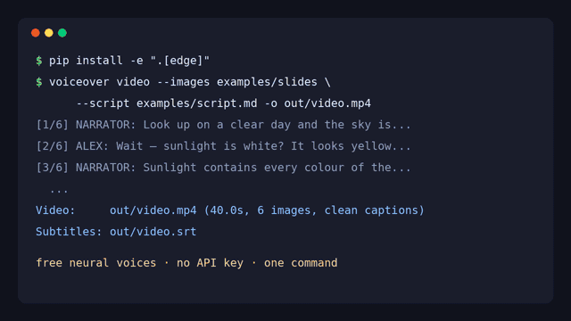

<div align="center">

[English](README.md) · **简体中文** · [日本語](README.ja.md) · [Español](README.es.md)

# AI Voiceover Studio — 一份脚本生成 AI 配音、字幕和无人出镜视频

**AI Voiceover Studio 是一个开源的 Python 命令行工具和库：一条命令把 Markdown 脚本变成完整的 AI 配音——多角色旁白、SRT 字幕，以及带字幕的无人出镜（faceless）视频。开箱即用免费神经网络语音（无需账号、无需 API Key），接入 Miragea 后还支持声音克隆和更有表现力的声音。**

[](https://github.com/yanghhu/ai-voiceover-studio/actions/workflows/tests.yml)
[](https://www.python.org/)
[](LICENSE)
[](pyproject.toml)



<sub>真实输出、未经剪辑：[带声音的完整视频（MP4，40 秒）](docs/assets/demo.mp4) · [纯配音（MP3）](docs/assets/sample-voiceover.mp3) · [字幕（SRT）](docs/assets/sample-voiceover.srt) · [中文竖屏短视频（MP4）](docs/assets/demo-short-zh.mp4)</sub>

</div>

## 快速开始（三行命令）

```bash
git clone https://github.com/yanghhu/ai-voiceover-studio && cd ai-voiceover-studio
pip install -e ".[edge]"
voiceover video --images examples/slides --script examples/script.md -o out/video.mp4
```

就这些。你会得到 `out/video.mp4`（1080p、两个声音、Ken Burns 动效、烧录字幕）、`out/video.srt`，以及 `out/video_voiceover/` 里的配音音轨。需要 Python 3.9+ 和 [ffmpeg](https://ffmpeg.org)，`voiceover doctor` 会帮你检查。

```bash
voiceover script examples/script.zh.md -o out/      # 只要音频：out/voiceover.mp3 + .srt + manifest.json
voiceover say "欢迎回到我的频道！" -o hello.mp3
voiceover video --script examples/script.zh.md -o short.mp4 --size 1080x1920 --style bold   # 竖屏短视频，无需图片
voiceover doctor                                    # 检查 ffmpeg、引擎、密钥、中文字体
```

不需要音色配置文件：脚本里的每个角色会按脚本语言自动分配不同的声音（中文默认云希 / 晓晓）。

## 为什么做这个

做 YouTube 讲解、教程或无人出镜频道，配音流程往往是：写脚本 → 一段段粘进 TTS 工具 → 下载一堆音频 → 在剪辑软件里对齐 → 再转写一遍做字幕。AI Voiceover Studio 直接从一个 Markdown 文件完成这一整套流程，并且可重复执行：改了脚本只需重跑一条命令，只有改动的那几行会重新生成。

## 功能

| | 能做什么 |
| --- | --- |
| 🆓 **免注册即用** | 默认引擎为免费的微软 Edge 神经网络语音（`edge-tts`），322 个声音、75 种语言，无需账号和密钥 |
| 🎭 **多角色脚本** | Markdown/TXT 中写 `[旁白]:`、`[小林]:`，每个角色自动分配不同声音，也可在 `voices.json` 指定 |
| 🎞️ **无人出镜视频** | 图片（或只有脚本）→ 带 Ken Burns 推拉、交叉淡化、进度条和样式化烧录字幕的 MP4 |
| 💬 **精准字幕** | 按引擎返回的句子边界计时生成 SRT，或对成品音轨做语音识别；中文断行友好 |
| 🎨 **字幕样式** | `clean`、`box`、`bold`（短视频）、`minimal`；可显示说话人；横竖屏自动适配字号 |
| 🧬 **声音克隆** | 使用 Miragea 引擎：用参考音频 URL（及其原文）代替现成音色 |
| ♻️ **可安全重跑** | 分段缓存 + 确定性幂等键，未改动的行不会重复生成 |
| 🔌 **可插拔引擎** | `edge`、`miragea`、`openai`、离线 `dummy`，或通过 `VoiceProvider` 接口接入自己的引擎 |
| 🩺 **`voiceover doctor`** | 检查 ffmpeg（libass）、引擎、API 密钥和中文字体，并给出具体修复方法 |
| 🤖 **适配 Agent** | 附带 Agent 技能文件和 `--json` 输出，适用于 Claude Code、Codex、Cursor |
| 🪶 **轻量核心** | 核心只用标准库；引擎为可选扩展；视频直接由 ffmpeg 渲染 |

## 配音引擎

| 引擎 | 配置 | 适合 |
| --- | --- | --- |
| `edge`（未设置密钥时的默认） | `pip install -e ".[edge]"`，无需账号和密钥 | 快速试用、出草稿、多语言 |
| `miragea`（设置 `MIRAGEA_API_KEY` 后的默认） | `export MIRAGEA_API_KEY=...`（[创建密钥](https://miragea.ai/workspace/api)） | 参考音频声音克隆、带情绪标签的表现力模型、字幕识别 |
| `openai` | `export OPENAI_API_KEY=...` | OpenAI 音色（`alloy`、`nova`、`onyx` 等） |
| `dummy` | 无（`--dry-run`） | 离线测试和 CI：带真实时长的静音音频 |

用 `--provider 名称` 或 `VOICEOVER_PROVIDER` 选择引擎。`voiceover voices --provider edge --filter zh-CN` 列出 Edge 声音（如 `zh-CN-XiaoxiaoNeural`）；`voiceover voices` 列出 Miragea 账号里保存的角色。`MIRAGEA_BASE_URL`（默认 `https://miragea.ai/v1`）可指向私有部署。密钥只从环境变量读取，不会被打印或写入 `manifest.json`。

Edge 声音来自微软在线朗读服务（通过社区包 `edge-tts`），需要联网，并受微软条款约束。若所在网络的 HTTPS 代理无法被 edge-tts 使用，可设置 `VOICEOVER_EDGE_PROXY`。

## 多角色脚本（对话与配音）

```markdown
# 三十秒讲清楚：为什么天空是蓝色的

[旁白]: 晴天抬头，天空是蓝色的。可阳光明明是白色的，蓝色从哪里来？

[小林](tags=好奇): 阳光是白色的？我一直以为是黄色的。

[pause 0.8]

[旁白](speed=1.05): 波长短的蓝光更容易被散射，于是整片天空都泛着蓝。
```

规则：`[名字]:` 指定说话人；没有标签的行沿用当前说话人；空行开始新的一段；`[pause 1.5]` 插入停顿；`(tags=a|b, speed=1.1, model=..., lang=...)` 设置单行参数。标题、HTML 注释、代码块和表格会被跳过，Markdown 强调与链接按纯文本朗读。过长的段落会在句末自动拆分，以符合引擎单次字数上限。

不写配置时每个角色会自动分配不同声音；想自己指定，在 `voices.json` 中为角色设置音色（Edge 声音名如 `zh-CN-YunjianNeural`，或 Miragea 的 actor id，参见 [examples/voices.example.json](examples/voices.example.json)）：

```json
{
  "default": { "actor_id": "YOUR_ACTOR_ID" },
  "旁白":    { "actor_id": "YOUR_ACTOR_ID", "model": "standard" },
  "小林":    { "reference_audio_url": "https://example.com/lin.wav",
               "reference_text": "lin.wav 里实际说出的内容。" }
}
```

```bash
voiceover script examples/script.zh.md --voices voices.json -o out/ --gap 0.4
```

输出：`out/voiceover.mp3`（完整音轨）、`out/voiceover.srt`（对齐字幕）、`out/segments/*.wav`（每段音频，也是下次运行的缓存）、`out/manifest.json`（每段的说话人、文本、起止时间、任务 ID 与幂等键）。改一行再跑，只会重新生成那一行；想全部重新录一版用 `--fresh`。

## 用参考音频克隆声音

声音克隆使用 Miragea 引擎（需 `MIRAGEA_API_KEY`）：

```bash
voiceover say "这是用文字生成的我自己的声音。" \
  --voice https://example.com/my-voice.wav \
  --ref-text "my-voice.wav 里我实际说的话。" \
  --lang zh -o cloned.mp3
```

`--voice` 以 `http(s)://` 开头时视为参考音频，否则视为 actor id。URL 需要能被 API 服务器访问。提供准确的参考文本（`--ref-text`）效果最可靠；省略时由引擎自动识别参考音频。请只克隆你本人或已获授权的声音。

## 字幕（SRT）

| 模式 | 方式 | 适用场景 |
| --- | --- | --- |
| `--subtitles timing`（默认） | 按引擎返回的句子边界（edge）或每段实际时长生成，文字取自脚本 | 以脚本为准，无额外 API 调用，没有识别错误 |
| `--subtitles recognize` | 把成品音轨提交到 Miragea 字幕识别接口 | 需要严格跟随实际语音的时间轴 |
| `--subtitles none` | 不生成字幕 | 纯音频项目 |

字幕在句子和分句处切分，并按两行换行（支持中日韩文字）。可以在 YouTube 工作室 →「字幕」上传 `.srt`，或直接烧录进视频。

## 用图片和脚本生成无人出镜 YouTube 视频

```bash
voiceover video --images examples/slides --script examples/script.md -o video.mp4
voiceover video --script examples/script.zh.md -o short.mp4 --size 1080x1920 --style bold   # 竖屏，无需图片
voiceover video --images slides/ --script script.md -o video.mp4 --style box --speaker-labels
```

| 选项 | 默认 | 作用 |
| --- | --- | --- |
| `--images 目录` | 渐变背景 | 按文件名排序；图片数等于段数时，每张图正好对应一段旁白 |
| `--subtitles burn\|sidecar\|none` | `burn` | 烧录样式化字幕（同时输出 `.srt`）、仅外挂、或不要字幕 |
| `--style clean\|box\|bold\|minimal` | `clean` | 字幕外观；`bold` 为居中大字，适合 Shorts / 抖音 |
| `--motion kenburns\|none` | `kenburns` | 缓慢缓动推拉与平移，每张图方向交替 |
| `--transition 秒` | `0.5` | 图片之间交叉淡化（`0` 为硬切） |
| `--size 宽x高` | `1920x1080` | 竖屏用 `1080x1920` |
| `--title 文本` / `--no-title` | 无图片时显示脚本第一个 `#` 标题 | 片头标题 |
| `--speaker-labels` | 关 | 字幕上方显示说话人 |
| `--font 字体名或文件` | Inter，缺字时回退系统字体 | 中文字幕需安装中文字体（`voiceover doctor` 会检查） |

视频由一条 ffmpeg 命令渲染（libass 字幕、`xfade` 转场），不再依赖 Python 视频库。示例图片由 [`examples/make_slides.py`](examples/make_slides.py) 绘制。

## 在 Python 中使用

```python
from voiceover_studio import Studio

studio = Studio()   # 默认 edge；设置了 MIRAGEA_API_KEY 时为 miragea
studio.say("你好！", None, "hello.mp3")                      # 按文字语言自动选声音
studio.say("你好！", "zh-CN-XiaoxiaoNeural", "xiaoxiao.mp3", speed=1.1)
result = studio.render_script("script.md", "out/")          # 每个角色自动分配声音
print(result.audio_path, result.srt_path)
```

## 在 AI 编程 Agent 中使用

[`skills/ai-voiceover/SKILL.md`](skills/ai-voiceover/SKILL.md) 可直接用于 Claude Code、Codex、Cursor 等 Agent。把该目录复制到 Agent 的技能目录后，直接说：“用 voices.json 里的音色给 script.md 配音，并生成字幕。” 所有命令都支持 `--json`，退出码固定（0 成功、1 任务失败、2 参数/API 错误）。

## 架构

脚本解析（`script.py`）→ 角色音色映射（`config.py`）→ 分段缓存与调度（`studio.py`）→ 引擎（`providers/`：`miragea.py` 异步任务 + 轮询 + 下载，`dummy.py` 离线）→ 拼接与导出（`audio.py`）→ 字幕（`subtitles.py`）→ 可选视频（`video.py`）。详见英文版 [Architecture](README.md#architecture)。

可靠性：异步任务按服务端 `poll_after_seconds` 轮询，等待超时会返回任务 ID，可用 `voiceover task <id> --wait` 继续；每个创建请求都带有由请求内容计算出的 `Idempotency-Key`，网络中断后重试或重跑脚本都会返回原任务；只在 API 标记 `retryable` 时用同一个键重试；401/403/409/413/429 都有明确提示。

## 支持的语言

- **edge**：75 种语言（`voiceover voices --provider edge`）；中、英、日、韩、西、法、德、意、葡、俄会按脚本文字或 `--lang` 自动选声音。
- **miragea**：中文、英语、日语、韩语、德语、法语、俄语、葡萄牙语、西班牙语、意大利语，支持声音克隆。

## 对比

| | 自己录音 | 网页 TTS 编辑器 | 直接调用 TTS API | **AI Voiceover Studio** |
| --- | --- | --- | --- | --- |
| 一个文件写完多角色脚本 | 手动 | 通常逐段 | 需自己写代码 | ✅ 内置 |
| 只重新生成改动的行 | 重录 | 手动 | 需自己写代码 | ✅ 缓存 + 幂等 |
| 字幕 | 另做 | 不一定 | 另做 | ✅ 自带 SRT |
| 无人出镜视频 | 剪辑软件 | 不一定 | 无 | ✅ 可选 |
| 可脚本化 / CI / Agent | 否 | 否 | 是 | ✅ |
| 更换引擎 | — | 否 | 重写 | ✅ 引擎接口 |
| 真人表演感 | ✅ 最好 | 取决于引擎 | 取决于引擎 | 取决于引擎 |

## 常见问题

更多见 [docs/FAQ.md](docs/FAQ.md)。

**怎么给 YouTube 视频加 AI 配音？** 把旁白写进 Markdown，运行 `voiceover script script.md --voices voices.json -o out/`，把 `out/voiceover.mp3` 放进剪辑时间线，并把 `out/voiceover.srt` 上传为字幕。完全不想剪辑，可用 `voiceover video` 直接生成视频。

**能克隆我自己的声音吗？** 可以。把一段清晰的录音放在 API 能访问的 URL，用 `--voice https://.../me.wav --ref-text "录音原文"`；也可以在 Miragea 账号里保存为角色后用 actor id。

**支持哪些语言？** 中文、英语、日语、韩语、德语、法语、俄语、葡萄牙语、西班牙语、意大利语。

**没有 API Key 能用吗？** 能。默认的 `edge` 引擎免费、无需账号；`--dry-run` 完全离线。Miragea 密钥额外提供声音克隆和表现力音色。

## 路线图

已完成：演示 GIF 与示例视频、免费默认引擎（edge）与 OpenAI 引擎、Ken Burns 动效与字幕样式、`voiceover doctor`。计划中：脚本内嵌图片控制切换；背景音乐自动闪避；逐字高亮字幕；翻译并配音；并发生成；发布到 PyPI。

## 参与贡献

欢迎提交问题、文档、新引擎和功能，见 [CONTRIBUTING.md](CONTRIBUTING.md)。

```bash
pip install -e ".[dev,edge,yaml]"
pytest            # 完全离线，无需 API Key
```

## 许可证

[MIT](LICENSE) © 2026 Miragea contributors
