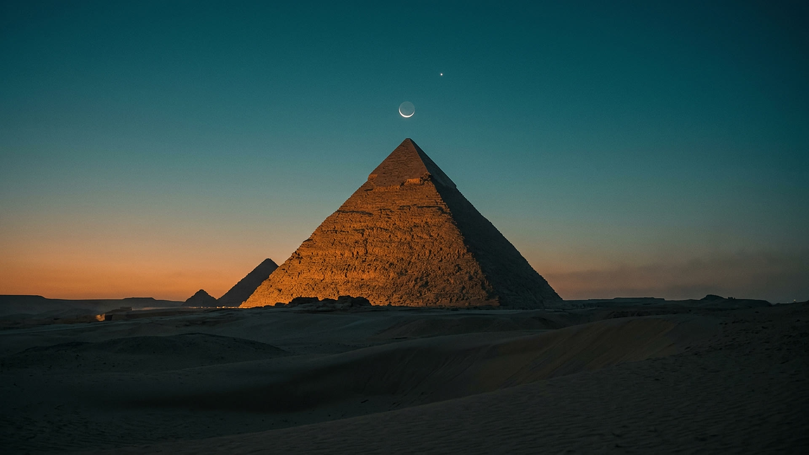
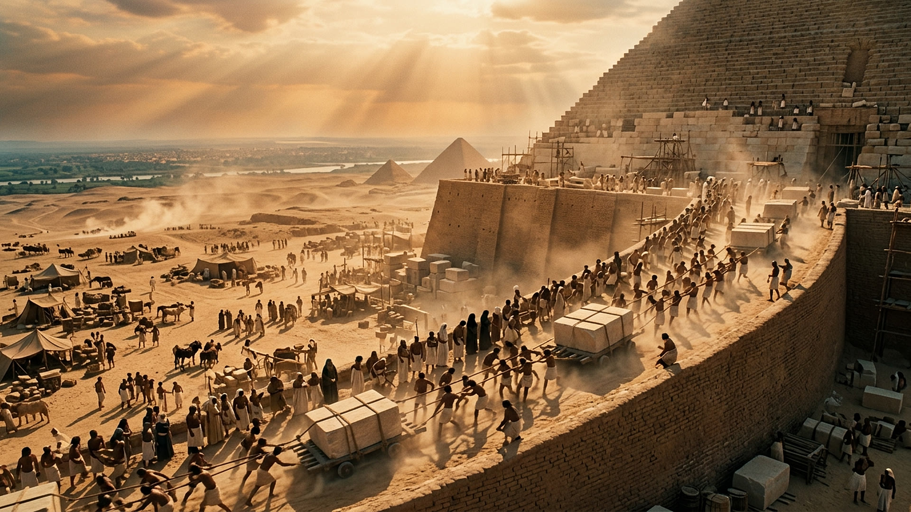
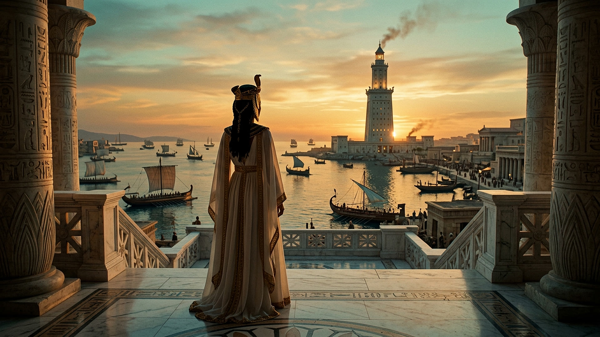
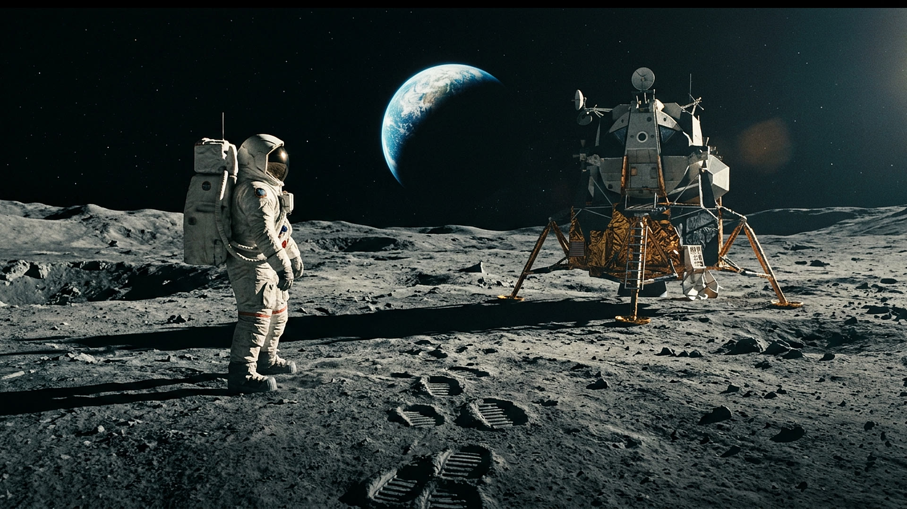
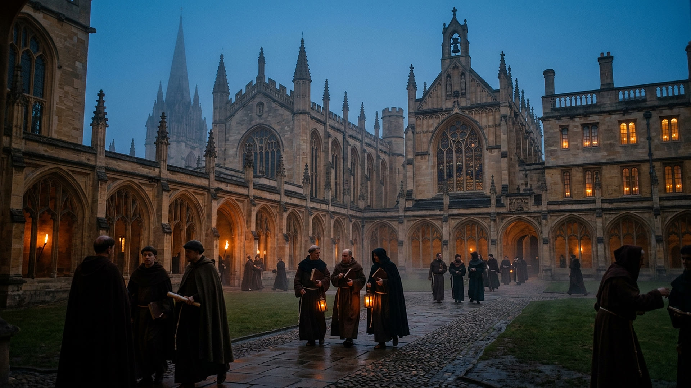

# Cleopatra vs. the Moon landing

<!-- Faceless-video demo. Each  line sets the B-roll for the paragraph below it;
     **bold** words become highlighted keywords in the captions.
     Render: voiceover video --script examples/demo.en.md --music ambient -o demo.mp4 -->

Cleopatra lived closer to the **Moon landing** than to the building of the Great Pyramid.

The pyramid at Giza was finished around 2560 BC. Cleopatra was born about **2,500 years** later.

To her, the pyramids were already more ancient than she is to us.

From Cleopatra to Neil Armstrong? Only about **2,000 years**.

It gets stranger. **Woolly mammoths** were still alive on a remote Arctic island while the pyramids were rising.

And **Oxford** was already teaching students before the **Aztec** capital was even founded.

History is not a neat line. It **overlaps**. Follow for more.
