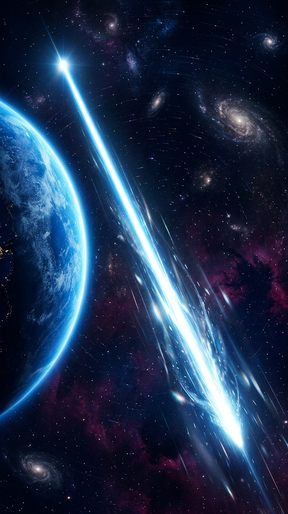
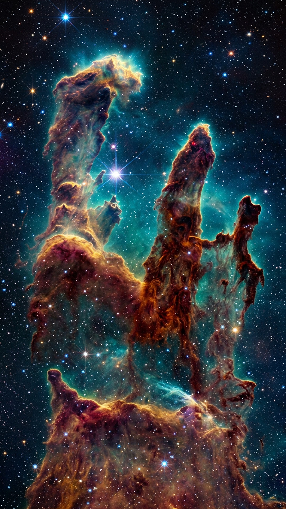
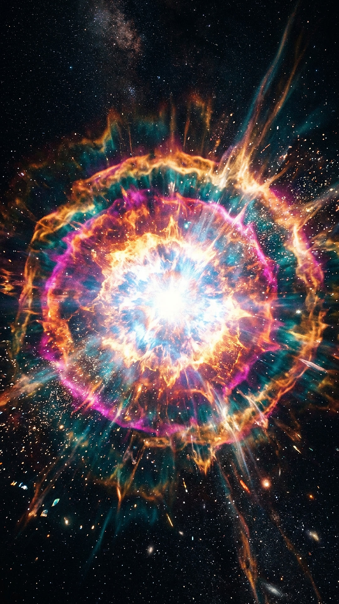

# 你看到的星星，可能早就不在了

<!-- 竖屏 Short 演示。每个  是下一段的画面；**加粗** 的词会在字幕里高亮。
     渲染：voiceover video --script examples/demo.zh.md --vertical --music ambient -o short.mp4 -->

今晚抬头看到的星光，可能来自一颗**早已消失**的恒星。

光每秒能跑**三十万公里**，可宇宙实在太大了。

有些星光在路上走了**几千年**，才刚刚抵达你的眼睛。

这期间，那颗星也许早已**爆炸**，化作一片星云。

所以你看到的，其实是宇宙的**过去**。关注我，每天一个冷知识。
